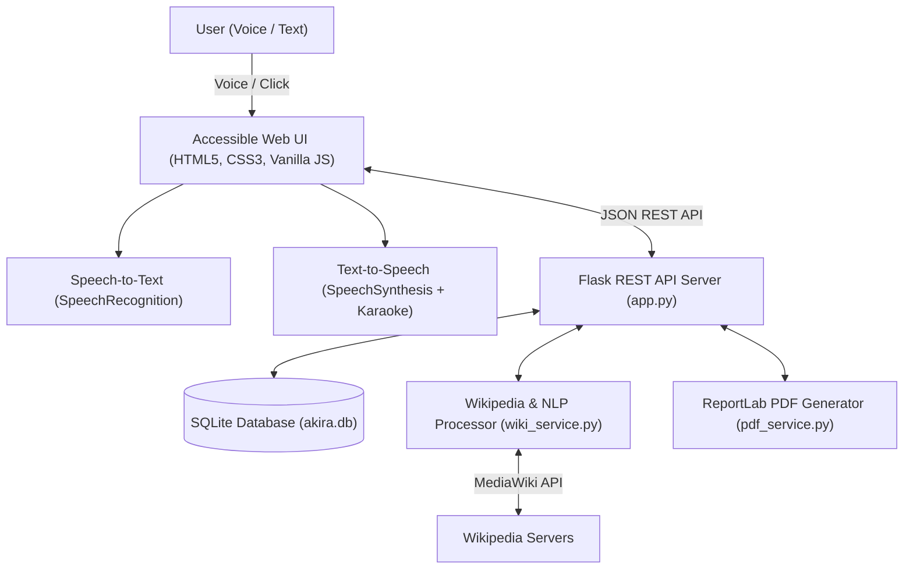

# AKIRA — Accessible Knowledge & Information Retrieval Assistant

[](https://www.python.org/downloads/)
[](https://flask.palletsprojects.com/)
[](https://www.sqlite.org/)
[](https://developer.mozilla.org/en-US/docs/Web/API/Web_Speech_API)
[](https://opensource.org/licenses/MIT)

**AKIRA** (*Accessible Knowledge & Information Retrieval Assistant*) is an open-source, multi-modal knowledge portal and study assistant. It transforms dense online encyclopedic entries into concise audio summaries, high-yield bullet takeaways, interactive 3D study flashcards, and downloadable study notes.

Designed with accessibility at its core, AKIRA features **two-way voice navigation** (Speech-to-Text and Text-to-Speech), **synchronized sentence-level "karaoke" highlighting** for dyslexic and auditory learners, and an **academic SafeSearch filter**.

---

## 🌟 Key Features

- **🎙️ Two-Way Voice Navigation:**
  - **Voice Search (Speech-to-Text):** Click-to-speak voice queries with live real-time transcription feedback and natural language filler word stripping (*"what is"*, *"tell me about"*).
  - **Interactive Audio Player (Text-to-Speech):** Play, Pause, Resume, Stop controls with dynamic live speed regulation (`0.75x`, `1.0x`, `1.25x`, `1.5x`) and native voice accent selection.
- **✨ Synchronized "Karaoke" Sentence Tracking:**
  - Visually highlights each sentence in real-time as it is spoken aloud, helping individuals with dyslexia, ADHD, or visual tracking difficulties read along.
- **🧠 Multi-Level Knowledge Synthesis:**
  - **Executive Audio Recap:** 2–3 sentence brief optimized for a 1-minute audio overview.
  - **Key Takeaways:** 3–4 high-yield bullet points summarizing core concepts and real-world significance.
  - **Study Flashcards:** 3–5 automatically generated interactive 3D flip-cards for active revision.
  - **Full Clean Text:** Complete article with citation markers and brackets cleanly stripped.
- **🛡️ Academic SafeSearch & Smart Auto-Resolution:**
  - Enforces an academic content safety filter suppressing adult and non-scholarly suggestions.
  - Smart auto-resolution connects query variations (e.g., `"generating AI"`) directly to canonical entries (**`Generative AI`**).
- **♿ Inclusive Accessibility Suite:**
  - Dyslexia-friendly typography toggle (`OpenDyslexic` font rules).
  - High-contrast dark and light themes conforming to WCAG standards.
  - Interactive font size scaling (`A-`, `A`, `A+`).
- **💾 Persistence & Document Export:**
  - Search history and bookmarked articles stored in a local SQLite database (`akira.db`).
  - One-click downloadable **PDF Study Guides** (powered by ReportLab) and Markdown study notes.
- **💸 100% Free & Open-Source:**
  - Zero paid third-party API dependencies or subscription costs.

---

## 🏗️ System Architecture



---

## 🛠️ Step-by-Step Setup Guide

Follow these instructions to set up and run AKIRA locally on your machine.

### 1. Prerequisites
Ensure you have the following installed on your system:
- **Python 3.10 or higher**: Verify by running `python --version` (or `python3 --version`).
- **Recommended Browser**: **Google Chrome** or **Microsoft Edge** (these browsers include native support for the Web Speech API's speech recognition).
- **Internet Connection**: Required for fetching real-time encyclopedic articles from Wikipedia.

---

### 2. Clone the Repository
Open your terminal (PowerShell, Command Prompt, or Bash) and clone the repository:

```bash
git clone https://github.com/s-yogeshwaran/AKIRA.git
cd AKIRA
```

---

### 3. Create & Activate a Virtual Environment (Recommended)

Using a virtual environment keeps project dependencies isolated and clean:

**On Windows (PowerShell):**
```powershell
python -m venv venv
.\venv\Scripts\Activate.ps1
```
*(If PowerShell displays an execution policy warning, run: `Set-ExecutionPolicy -Scope Process -ExecutionPolicy Bypass` and re-run the activate command).*

**On Windows (Command Prompt):**
```cmd
python -m venv venv
venv\Scripts\activate.bat
```

**On macOS / Linux:**
```bash
python3 -m venv venv
source venv/bin/activate
```

---

### 4. Install Dependencies
Install all required libraries using `pip`:

```bash
pip install -r requirements.txt
```

*Libraries installed:*
- `Flask`: Lightweight web server and REST API framework.
- `wikipedia`: Interface to Wikimedia API.
- `requests` & `beautifulsoup4`: Web data extraction and HTML cleanup.
- `reportlab`: Generation of structured, printable study guide PDFs.

---

### 5. Run the Automated Test Suite
Before launching the server, you can verify that all 16 unit, integration, and safety tests pass:

```bash
python test_akira.py
```

**Expected output:**
```
Ran 16 tests in ~3.0s

OK
```
*Tests cover database CRUD operations, academic content safety filtering, smart search resolution, sentence splitting with honorific preservation, flashcard guarantees, PDF layout stability, and frontend JavaScript syntax.*

---

### 6. Start the Web Server
Launch the Flask development server:

```bash
python app.py
```

You will see output similar to:
```
 * Serving Flask app 'app'
 * Debug mode: on
 * Running on http://127.0.0.1:5000
```

---

### 7. Access the Application
Open **Google Chrome** or **Microsoft Edge** and visit:
👉 **[http://127.0.0.1:5000](http://127.0.0.1:5000)**

---

## 🎯 Quick Verification & Demo Walkthrough

Once the application is running in your browser, test the key features:

| Feature to Test | How to Test | What to Look For |
| :--- | :--- | :--- |
| **1. Voice Search (STT)** | Click the 🎙️ **Microphone** button and say: *"What is generative AI"* | Words appear live in the search bar; filler prefix *"what is"* is automatically removed and the article loads. |
| **2. Text Search & Auto-Resolution** | Type `"generating AI"` and press **Search** | AKIRA automatically resolves minor typos and lands directly on **`Generative AI`**. |
| **3. Audio Player & Speed** | Click the **▶ Play** button in the bottom floating deck | Speech begins reading the summary aloud. Click the preset chips (**`1.25x`** or **`1.5x`**) or move the slider—the audio speed updates immediately. |
| **4. Karaoke Highlighting** | Watch the article text while audio is playing | Each spoken sentence is highlighted in blue in real-time as it is spoken. Click any sentence to jump playback to that spot. |
| **5. Interactive Flashcards** | Click on the **Study Flashcards** tab | Click on any card (or press Space) to flip it and reveal the key concept definition. |
| **6. Academic SafeSearch** | Search for an explicit or non-academic term | The system safely catches it and displays: *"This topic is restricted under academic content safety guidelines."* |
| **7. Accessibility Controls** | Click **Dyslexic Font**, **A- / A+**, or the **Theme** selector in the top bar | Typography instantly switches to dyslexia-friendly letter-spacing, text scales smoothly, and dark/light modes toggle cleanly. |
| **8. Bookmarks & PDF Export** | Click **★ Bookmark** then **Download Study PDF** | Article is saved to SQLite history and a formatted study guide PDF downloads to your computer. |

---

## 📁 Project Structure

```
.
├── app.py                      # Flask application server & REST endpoints
├── db.py                       # SQLite database manager (CRUD operations)
├── wiki_service.py             # Wikipedia API integration, NLP parser & SafeSearch
├── pdf_service.py              # ReportLab study guide PDF generator
├── requirements.txt            # Python dependencies
├── test_akira.py               # Comprehensive 16-test automated verification suite
├── .gitignore                  # Git ignore rules (excludes akira.db, __pycache__)
├── README.md                   # Project documentation & setup instructions
│
├── static/
│   ├── css/
│   │   ├── style.css           # Core styling, responsive layout, audio player deck
│   │   └── accessibility.css   # Dyslexia typography, contrast themes, karaoke highlight
│   └── js/
│       ├── api.js              # Asynchronous REST client
│       ├── speech.js           # Two-way Web Speech API engine (STT & TTS)
│       └── main.js             # UI controller and interactive event bindings
│
├── templates/
│   └── index.html              # Accessible single-page web dashboard
│
└── docs/                       # Project documentation & reference files
    ├── ABSTRACT.md             # 1-page academic abstract
    ├── PROJECT_COMPREHENSIVE_REPORT.md # Master project technical report
    └── diagrams/               # System architecture and DFD diagrams
```

---

## ❓ Frequently Asked Questions & Troubleshooting

#### 1. Microphone not working during Voice Search
- Ensure you are using **Google Chrome** or **Microsoft Edge**.
- When prompted by the browser, click **Allow** to give microphone permissions.
- You can reset microphone permissions by clicking the padlock / tune icon on the left side of the browser's address bar.

#### 2. Port 5000 is already in use
If another application (like AirPlay on macOS) is using port 5000, you can run AKIRA on a different port:
```bash
python -c "import app; app.app.run(port=5055, debug=True)"
```
Then navigate to `http://127.0.0.1:5055`.

#### 3. Where is search history and bookmarks saved?
All data is stored locally in `akira.db` (SQLite) created automatically in the root folder upon the first run. No external database setup is required.

---

## 📄 License
This project is licensed under the MIT License — see the [LICENSE](LICENSE) file for details.
