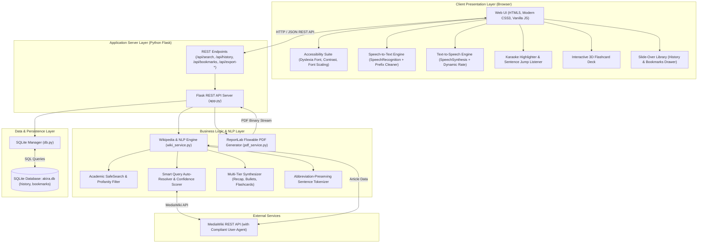

# AKIRA — Accessible Knowledge & Information Retrieval Assistant

[](https://www.python.org/downloads/)
[](https://flask.palletsprojects.com/)
[](https://www.sqlite.org/)
[](https://developer.mozilla.org/en-US/docs/Web/API/Web_Speech_API)
[](LICENSE)

**AKIRA** (*Accessible Knowledge & Information Retrieval Assistant*) is an advanced, multi-modal knowledge portal and assistive study platform. It transforms dense online encyclopedic entries into concise audio summaries, high-yield bullet takeaways, interactive 3D study flashcards, and downloadable study notes.

Designed with universal accessibility at its core, AKIRA features **two-way voice navigation** (Speech-to-Text and Text-to-Speech), **synchronized sentence-level "karaoke" highlighting** for dyslexic and auditory learners, and an **academic SafeSearch filter**.

---

## 🌟 Comprehensive Key Features

### 1. 🎙️ Two-Way Voice Navigation
* **Voice Search (Speech-to-Text):** Click-to-speak voice search powered by the browser's native `SpeechRecognition` interface.
* **Live Transcription Feedback:** Transcribed words stream live into the search input box as you speak.
* **Conversational Filler Stripping:** Intelligent regex pre-processor strips conversational phrases (*"what is"*, *"what's"*, *"tell me about"*, *"search for"*, *"who was"*, *"explain"*, *"define"*), converting natural spoken questions like *"what is generative AI"* into clean search queries.
* **Locale & Accent Adaptation:** Automatically detects browser locale with support for Indian English (`en-IN`) and standard English accents.
* **Interactive Audio Player (Text-to-Speech):** Complete playback controls (**Play**, **Pause**, **Resume**, **Stop**).
* **Dynamic Live Speed Regulation:** Adjust speed smoothly via the slider or 4 instant preset chips (**`0.75x`**, **`1.0x`**, **`1.25x`**, **`1.5x`**)—the active sentence re-speaks at the new rate immediately without audio freezing.
* **Voice Selector:** Dropdown menu dynamically enumerating all installed OS and browser synthesis voices.
* **Keyboard Shortcut:** Press `Spacebar` anytime to toggle audio Play/Pause.

### 2. ✨ Synchronized "Karaoke" Sentence Highlighting
* **Live Visual Tracking:** Highlights the active spoken sentence in real-time with an accessible visual glow as the voice speaks.
* **Dual-View Highlighting:** Works across both the **Executive Audio Recap** and the **Key Takeaways** tab views.
* **Interactive Sentence Jumping:** Users can click on *any* individual sentence in the text or takeaways list to instantly jump audio playback to that exact spot.

### 3. 🧠 Multi-Level Knowledge Synthesis & Study Tools
* **Executive Audio Recap:** A concise 2–3 sentence summary engineered for a 1-minute audio brief.
* **Key Takeaways:** 3–4 high-yield bullet points summarizing core concepts and real-world significance.
* **Interactive 3D Study Flashcards:** 3–5 automatically generated revision cards (Definition, Mechanism, Applications, Historical Origins) with 3D flip animation and scrollable text containers to prevent overflow.
* **Full Clean Text:** Complete article with citation brackets (`[1]`, `[citation needed]`, `== References ==`) cleanly stripped.

### 4. 🛡️ Academic SafeSearch & Smart Auto-Resolution
* **Academic Safety Filter:** Built-in regex blocklist that suppresses adult, NSFW, pornographic, vulgar, and slop suggestions/topics. Searches for explicit topics return: *"This topic is restricted under academic content safety guidelines."*
* **Literary Safety Whitelist:** Preserves valid academic, literary, and historical subjects (e.g., *"Moby Dick"*, *"Philip K. Dick"*, *"Charles Dickens"*, *"oilseed rape"*).
* **Smart Auto-Resolution:** If a query has a minor variation or typo (e.g., `"generating AI"`), AKIRA evaluates top search results using whole-word boundary matching and token overlap, automatically loading the canonical article (**`Generative AI`**) without error screens.

### 5. ♿ Inclusive Accessibility Suite (WCAG Compliant)
* **Dyslexia Font Mode:** One-click toggle applying high-legibility typographic styling (`OpenDyslexic` rules, expanded letter spacing, enhanced line-height).
* **High-Contrast Dark / Light Themes:** Accessible color palettes meeting WCAG contrast ratios.
* **Interactive Font Scaling:** Instant font magnification controls (**`A-`**, **`A`**, **`A+`**).
* **Accessible Navigation:** Skip-to-content links and ARIA attributes for screen readers.

### 6. 💾 Persistence, Slide-Over Library & Study Exports
* **SQLite Relational Storage (`akira.db`):** Full CRUD management for search history and bookmarked articles.
* **Slide-Over Side Drawer:** Quick-access slide-out library to browse saved bookmarks and past searches without leaving the active article.
* **Formatted PDF Study Guide:** On-the-fly downloadable, multi-page PDF document generated with ReportLab, featuring executive summary callouts, bullet takeaways, and revision tables.
* **Markdown Notes Export:** Downloadable `.md` study notes for personal knowledge bases (Notion, Obsidian).

### 7. 🔒 Self-Contained & Free Architecture
* Runs with zero paid third-party API dependencies or subscription costs, relying on robust local Python services and browser-native APIs.

---

## 🏗️ Detailed System Architecture

The architecture follows a modular **Model-View-Controller (MVC) / Client-Server** pattern matching the academic design diagrams:



---

## 🛠️ Step-by-Step Setup Guide

Follow these instructions to set up and run AKIRA locally on your machine.

### 1. Prerequisites
Ensure you have the following installed on your system:
- **Python 3.10 or higher**: Verify by running `python --version` (or `python3 --version`).
- **Recommended Browser**: **Google Chrome** or **Microsoft Edge** (these browsers include native support for the Web Speech API's speech recognition).
- **Internet Connection**: Required for fetching real-time encyclopedic articles from Wikipedia.

---

### 2. Clone the Repository
Open your terminal (PowerShell, Command Prompt, or Bash) and clone the repository:

```bash
git clone https://github.com/s-yogeshwaran/AKIRA.git
cd AKIRA
```

---

### 3. Create & Activate a Virtual Environment (Recommended)

Using a virtual environment keeps project dependencies isolated and clean:

**On Windows (PowerShell):**
```powershell
python -m venv venv
.\venv\Scripts\Activate.ps1
```
*(If PowerShell displays an execution policy warning, run: `Set-ExecutionPolicy -Scope Process -ExecutionPolicy Bypass` and re-run the activate command).*

**On Windows (Command Prompt):**
```cmd
python -m venv venv
venv\Scripts\activate.bat
```

**On macOS / Linux:**
```bash
python3 -m venv venv
source venv/bin/activate
```

---

### 4. Install Dependencies
Install all required libraries using `pip`:

```bash
pip install -r requirements.txt
```

*Libraries installed:*
- `Flask`: Lightweight web server and REST API framework.
- `wikipedia`: Interface to Wikimedia API.
- `requests` & `beautifulsoup4`: Web data extraction and HTML cleanup.
- `reportlab`: Generation of structured, printable study guide PDFs.

---

### 5. Run the Automated Test Suite
Before launching the server, verify that all 16 unit, integration, and safety tests pass:

```bash
python test_akira.py
```

**Expected output:**
```
Ran 16 tests in ~3.0s

OK
```
*Tests cover database CRUD operations, academic content safety filtering, smart search resolution, sentence splitting with honorific preservation, flashcard guarantees, PDF layout stability, and frontend JavaScript syntax.*

---

### 6. Start the Web Server
Launch the Flask development server:

```bash
python app.py
```

You will see output similar to:
```
 * Serving Flask app 'app'
 * Debug mode: on
 * Running on http://127.0.0.1:5000
```

---

### 7. Access the Application
Open **Google Chrome** or **Microsoft Edge** and visit:
👉 **[http://127.0.0.1:5000](http://127.0.0.1:5000)**

---

## 🎯 Quick Verification & Demo Walkthrough

Once the application is running in your browser, test the key features:

| Feature to Test | How to Test | What to Look For |
| :--- | :--- | :--- |
| **1. Voice Search (STT)** | Click the 🎙️ **Microphone** button and say: *"What is generative AI"* | Words appear live in the search bar; filler prefix *"what is"* is automatically removed and the article loads. |
| **2. Text Search & Auto-Resolution** | Type `"generating AI"` and press **Search** | AKIRA automatically resolves minor typos and lands directly on **`Generative AI`**. |
| **3. Audio Player & Speed** | Click the **▶ Play** button in the bottom floating deck | Speech begins reading the summary aloud. Click the preset chips (**`1.25x`** or **`1.5x`**) or move the slider—the audio speed updates immediately. |
| **4. Karaoke Highlighting & Jumping** | Watch the article text while audio is playing | Each spoken sentence is highlighted in blue in real-time. Click any sentence in the text to jump playback to that spot. |
| **5. Interactive Flashcards** | Click on the **Study Flashcards** tab | Click on any card (or press Space) to flip it and reveal the key concept definition. |
| **6. Academic SafeSearch** | Search for an explicit or non-academic term | The system safely catches it and displays: *"This topic is restricted under academic content safety guidelines."* |
| **7. Accessibility Controls** | Click **Dyslexic Font**, **A- / A+**, or the **Theme** selector in the top bar | Typography instantly switches to dyslexia-friendly letter-spacing, text scales smoothly, and dark/light modes toggle cleanly. |
| **8. Bookmarks, Library & PDF Export** | Click **★ Bookmark**, open **Library**, then click **Download Study PDF** | Article is saved to SQLite, appears in the side drawer, and a formatted study guide PDF downloads to your computer. |

---

## 📁 Up-to-Date Project Structure

```
.
├── app.py                                  # Flask application server & REST endpoints
├── db.py                                   # SQLite database manager (CRUD operations)
├── wiki_service.py                         # Wikipedia API client, NLP parser & SafeSearch filter
├── pdf_service.py                          # ReportLab study guide PDF generator
├── requirements.txt                        # Python dependencies
├── test_akira.py                           # Comprehensive 16-test automated verification suite
├── .gitignore                              # Git ignore rules (excludes akira.db, __pycache__)
├── LICENSE                                 # Proprietary & All Rights Reserved License
├── README.md                               # Project documentation & setup instructions
├── PROJECT_COMPREHENSIVE_REPORT.md         # Full project master report
│
├── static/
│   ├── css/
│   │   ├── style.css                       # Core styling, responsive layout, audio player deck
│   │   └── accessibility.css               # Dyslexia typography, contrast themes, karaoke highlight
│   └── js/
│       ├── api.js                          # Asynchronous REST client
│       ├── speech.js                       # Two-way Web Speech API engine (STT & TTS)
│       └── main.js                         # UI controller, side drawer, interactive bindings
│
├── templates/
│   └── index.html                          # Accessible single-page web dashboard
│
└── docs/                                   # Project reports, review chapters, & diagrams
    ├── PROJECT_COMPREHENSIVE_REPORT.md     # Master project technical report
    ├── AKIRA_Study_Artificial_intelligence.pdf # Sample generated study guide PDF
    │
    ├── Figure 4.1_ AKIRA System Architecture.svg # System architecture diagram
    ├── Figure 4.2_Context-Level DFD of AKIRA.svg # DFD Level 0 (Context diagram)
    ├── Figure 4.3_ Level 1 DFD of AKIRA.svg      # DFD Level 1 diagram
    ├── Figure 4.4_ Use Case Diagram of AKIRA.svg # UML Use Case diagram
    ├── Figure 4.5_ AKIRA Database ER Diagram.svg # Entity-Relationship diagram
    ├── Activity Diagram.svg                      # System activity diagram
    │
    ├── Review files/                       # Complete MCA project documentation chapters
    │   ├── Abstract - AKIRA.docx
    │   ├── Analysis and Requirements - AKIRA.docx
    │   ├── Appendices - AKIRA.docx
    │   ├── Conclusion - AKIRA.docx
    │   ├── Design - AKIRA.docx
    │   ├── Implementation - AKIRA.docx
    │   ├── Introduction - AKIRA.docx
    │   ├── Problem Description_Modules Description - AKIRA.docx
    │   ├── References - AKIRA.docx
    │   ├── Testing - AKIRA.docx
    │   └── Tools and Technologies - AKIRA.docx
    │
    └── Old files/                          # Initial project reference files
        ├── Abstract.internship.pdf
        ├── Intro.Internship.pdf
        ├── REquirement.pdf
        └── Search!.py                      # Original CLI prototype (archived)
```

---

## ❓ Frequently Asked Questions & Troubleshooting

#### 1. Microphone not working during Voice Search
- Ensure you are using **Google Chrome** or **Microsoft Edge**.
- When prompted by the browser, click **Allow** to give microphone permissions.
- You can reset microphone permissions by clicking the padlock / tune icon on the left side of the browser's address bar.

#### 2. Port 5000 is already in use
If another application (like AirPlay on macOS) is using port 5000, you can run AKIRA on a different port:
```bash
python -c "import app; app.app.run(port=5055, debug=True)"
```
Then navigate to `http://127.0.0.1:5055`.

#### 3. Where is search history and bookmarks saved?
All data is stored locally in `akira.db` (SQLite) created automatically in the root folder upon the first run. No external database setup is required.

---

## 🔒 License & Copyright

**Proprietary & All Rights Reserved.**  
Copyright © 2026 **Yogeshwaran** ([@s-yogeshwaran](https://github.com/s-yogeshwaran)).

This project is made publicly viewable on GitHub strictly for educational demonstration, personal portfolio showcase, and academic evaluation purposes. 

**Restrictions:**  
No part of this software (including source code, styles, design, architecture, or documentation) may be copied, reproduced, modified, republished, distributed, sublicensed, sold, or used in any project without prior explicit written permission from the author.
