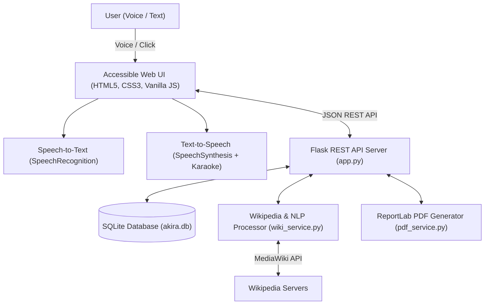

# AKIRA — Accessible Knowledge & Information Retrieval Assistant

[](https://www.python.org/downloads/)
[](https://flask.palletsprojects.com/)
[](https://www.sqlite.org/)
[](https://developer.mozilla.org/en-US/docs/Web/API/Web_Speech_API)
[](https://opensource.org/licenses/MIT)

**AKIRA** (*Accessible Knowledge & Information Retrieval Assistant*) is a full-stack, accessible knowledge portal and multi-modal study platform. It transforms dense online encyclopedic entries into concise audio summaries, high-yield bullet takeaways, interactive 3D study flashcards, and exportable study notes.

---

## 🌟 Key Features

- **🎙️ Two-Way Voice Navigation:**
  - **Voice Search (Speech-to-Text):** Click-to-speak voice queries with real-time visual feedback and natural language prefix stripping (*"what is"*, *"tell me about"*).
  - **Interactive Audio Player (Text-to-Speech):** Play, Pause, Resume, Stop controls with dynamic speed adjustment (0.75x to 1.5x) and native voice accent selection.
- **✨ Synchronized "Karaoke" Sentence Tracking:**
  - Highlights each spoken sentence in real-time as it is read aloud, assisting readers with dyslexia, ADHD, or visual tracking difficulties.
- **🧠 Multi-Level Knowledge Synthesis:**
  - **Executive Audio Recap:** 2–3 sentence brief for a 1-minute audio overview.
  - **Key Takeaways:** 3–4 bullet points highlighting fundamental concepts and real-world significance.
  - **Study Flashcards:** 3–5 automatically generated interactive 3D flip-cards for active revision.
  - **Full Clean Text:** Complete article with all citation markers and brackets cleanly stripped.
- **🛡️ Academic SafeSearch & Smart Resolution:**
  - Enforces an academic content safety filter that suppresses adult/slop suggestions.
  - Smart auto-resolution connects query variations (e.g., `"generating AI"`) directly to canonical entries (**`Generative AI`**).
- **♿ Inclusive Accessibility Suite:**
  - Dyslexia-friendly typography toggle (`OpenDyslexic` rules).
  - High-contrast dark and light themes conforming to WCAG contrast standards.
  - Interactive font size scaling (`A-`, `A`, `A+`).
- **💾 Persistence & Document Export:**
  - Search history and bookmarked articles stored in a local SQLite database (`akira.db`).
  - One-click downloadable **PDF Study Guides** (powered by ReportLab) and Markdown notes.
- **💸 100% Free & Open-Source:**
  - Zero paid third-party API dependencies or subscription costs.

---

## 🏗️ System Architecture



---

## 🚀 Getting Started

### 1. Prerequisites
- Python 3.10 or higher
- Modern Chromium-based browser (Google Chrome, Microsoft Edge, or Brave) for Web Speech API support

### 2. Installation

Clone the repository:
```bash
git clone https://github.com/<your-username>/<your-repo-name>.git
cd <your-repo-name>
```

Install the dependencies:
```bash
pip install -r requirements.txt
```

### 3. Run Automated Tests

Verify that all 16 unit, integration, and safety tests pass:
```bash
python test_akira.py
```

### 4. Start the Application

```bash
python app.py
```

Open your browser and navigate to:
```
http://127.0.0.1:5000
```

---

## 📁 Project Structure

```
.
├── app.py                      # Flask application and REST API endpoints
├── db.py                       # SQLite database manager (CRUD operations)
├── wiki_service.py             # Wikipedia API integration, NLP parser & SafeSearch
├── pdf_service.py              # ReportLab study guide PDF generator
├── requirements.txt            # Python dependencies
├── test_akira.py               # Automated test suite (16 test cases)
├── .gitignore                  # Git ignore rules
├── README.md                   # Project documentation
│
├── static/
│   ├── css/
│   │   ├── style.css           # Core styling, responsive layout, audio player deck
│   │   └── accessibility.css   # Dyslexia typography, contrast themes, karaoke highlight
│   └── js/
│       ├── api.js              # Asynchronous REST client
│       ├── speech.js           # Two-way Web Speech API engine
│       └── main.js             # UI controller and interactive event bindings
│
├── templates/
│   └── index.html              # Accessible single-page web dashboard
│
└── docs/                       # Project documentation & architectural diagrams
    ├── ABSTRACT.md             # 1-page academic abstract
    ├── PROJECT_COMPREHENSIVE_REPORT.md # Master project report
    └── diagrams/               # System architecture and DFD diagrams
```

---

## 🧪 Testing & Verification

The test suite covers:
- SQLite database initialization, transactions, and bookmark conflict resolution.
- Academic safety filter keyword interception and literary exception bypass.
- Smart search auto-resolution and conversational prefix stripping.
- Sentence boundary splitting with honorific and abbreviation preservation.
- ReportLab XML entity safety and multi-page layout stability.
- Client-side JavaScript speech engine logic validation.

Run all tests anytime with:
```bash
python -m unittest test_akira.py -v
```

---

## 📄 License
This project is licensed under the MIT License — see the [LICENSE](LICENSE) file for details.

